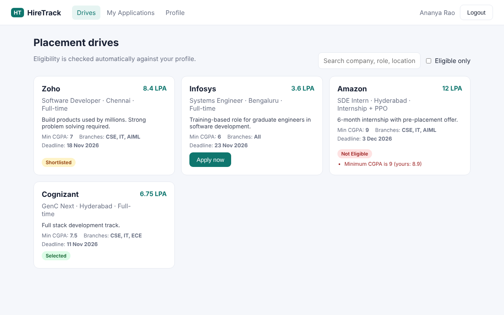
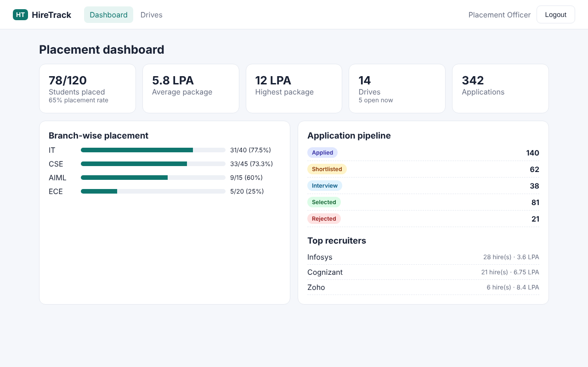
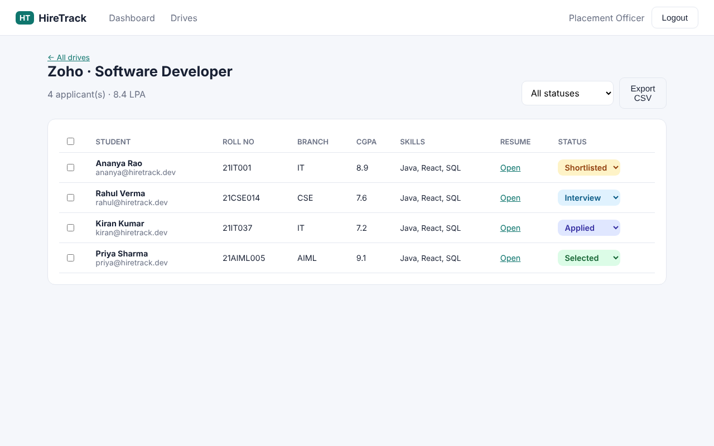
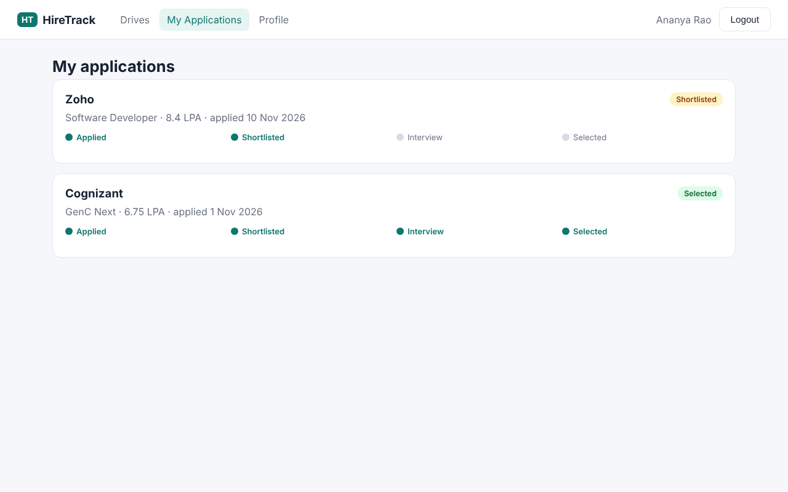
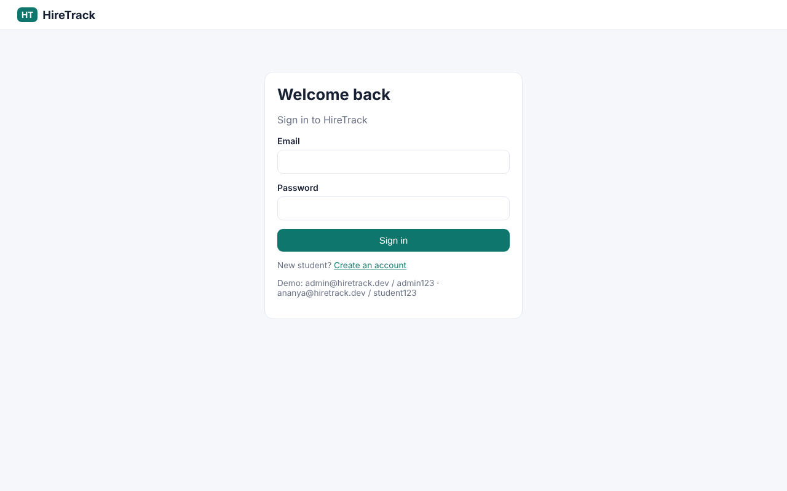

# HireTrack: Campus Placement Management System

    

HireTrack is a full-stack web app that digitises a college's placement process. The **placement officer (admin)** posts company drives with eligibility rules. **Students** see only the drives they qualify for, apply in one click and track their status. Admins shortlist candidates, export lists to CSV and see live placement statistics.



## Features

### Students
- Register and log in (JWT authentication, passwords hashed with bcrypt)
- See all drives with an **automatic eligibility check** (CGPA, branch, backlogs, batch, deadline), with the exact reasons when not eligible
- Search drives and filter to "eligible only"
- One-click apply (the server checks eligibility again and blocks duplicate applications)
- Track every application through **Applied → Shortlisted → Interview → Selected**
- Withdraw an application before shortlisting
- Edit profile: CGPA, backlogs, skills, resume link

### Placement officer (admin)
- **Dashboard**: students placed, placement rate, average and highest package, branch-wise placement %, application pipeline, top recruiters (MongoDB aggregation pipelines)
- Create, close/reopen and delete drives with eligibility rules
- View applicants per drive, filter by status, update status one by one or in **bulk**
- **Export applicants to CSV**

### Engineering
- Role-based access control on both the API (middleware) and the UI (protected routes)
- Centralised error handling with clear messages for validation, duplicate and invalid ID errors
- Unique compound index so a student can apply to a drive only once
- Eligibility logic is a pure function with **9 unit tests** (Node's built-in test runner)
- Security headers with Helmet, CORS restricted to the client URL
- Docker Compose setup and GitHub Actions CI

## Screenshots

| Admin dashboard | Applicants (bulk actions + CSV) |
|---|---|
|  |  |

| Application tracking | Login |
|---|---|
|  |  |

## Tech stack

| Layer | Technology |
|---|---|
| Frontend | React 18, React Router 6, Context API, Vite, CSS |
| Backend | Node.js, Express 4 |
| Database | MongoDB with Mongoose ODM |
| Auth | JSON Web Tokens, bcryptjs |
| Testing / DevOps | node:test, GitHub Actions, Docker Compose |

## Architecture

```
React (Vite) ──fetch + JWT──▶ Express REST API ──Mongoose──▶ MongoDB
   │                              │
   ├─ AuthContext (session)       ├─ protect / authorize middleware
   ├─ ProtectedRoute (by role)    ├─ routes: auth, drives, applications, stats
   └─ pages: student / admin      └─ utils/eligibility.js (pure, unit-tested)
```

### Data model

- **User**: name, email, password (hashed), role (`student` | `admin`), rollNo, branch, cgpa, backlogs, graduationYear, skills, resumeUrl
- **Drive**: company, role, ctc, location, jobType, eligibility `{ minCgpa, branches[], maxBacklogs, graduationYear }`, deadline, driveDate, status
- **Application**: student → User, drive → Drive, status, history `[{ status, note, at }]`, unique index on `(student, drive)`

## Getting started

### Prerequisites
- Node.js 18+
- MongoDB (local install, Docker, or a free MongoDB Atlas cluster)

### 1. Backend

```bash
cd server
npm install
cp .env.example .env        # then set MONGO_URI and JWT_SECRET
npm run seed                # optional: loads demo users, drives and applications
npm run dev                 # API on http://localhost:5000
```

### 2. Frontend

```bash
cd client
npm install
npm run dev                 # app on http://localhost:5173
```

### Demo accounts (after `npm run seed`)

| Role | Email | Password |
|---|---|---|
| Admin | admin@hiretrack.dev | admin123 |
| Student | ananya@hiretrack.dev | student123 |

### Run with Docker (API + MongoDB)

```bash
docker compose up --build
```

### Deploy (one service: API + React app)

The Express server also serves the built React app, so the whole project runs as a single web service (e.g. on Render):

- **Build command:** `npm run build`
- **Start command:** `npm start`
- **Environment variables:** `MONGO_URI` (MongoDB Atlas connection string), `JWT_SECRET`

On first start with an empty database, demo data is loaded automatically.

### Tests

```bash
cd server
npm test
```

## API reference

All routes except register/login need the header `Authorization: Bearer <token>`.

| Method | Endpoint | Access | Description |
|---|---|---|---|
| POST | `/api/auth/register` | Public | Student sign-up |
| POST | `/api/auth/login` | Public | Log in, returns JWT |
| GET / PUT | `/api/auth/me` | Logged in | Get or update own profile |
| GET | `/api/drives?search=&status=` | Logged in | List drives (students get eligibility + application status) |
| GET | `/api/drives/:id` | Logged in | Drive details |
| POST / PUT / DELETE | `/api/drives[/:id]` | Admin | Create, update, delete drive |
| POST | `/api/applications` | Student | Apply `{ driveId }` |
| GET | `/api/applications/me` | Student | My applications |
| DELETE | `/api/applications/:id` | Student | Withdraw (only while "applied") |
| GET | `/api/applications/drive/:driveId?status=` | Admin | Applicants for a drive |
| PATCH | `/api/applications/:id/status` | Admin | Update one status `{ status, note }` |
| PATCH | `/api/applications/bulk-status` | Admin | Update many `{ ids[], status }` |
| GET | `/api/stats` | Admin | Dashboard statistics |

## Project structure

```
hiretrack/
├── server/
│   ├── src/
│   │   ├── app.js, index.js, seed.js
│   │   ├── config/db.js
│   │   ├── middleware/ (auth.js, error.js)
│   │   ├── models/ (User, Drive, Application)
│   │   ├── routes/ (auth, drives, applications, stats)
│   │   └── utils/ (eligibility.js, token.js)
│   └── tests/eligibility.test.js
├── client/
│   └── src/
│       ├── api.js, App.jsx, main.jsx, index.css
│       ├── context/AuthContext.jsx
│       ├── components/ (Navbar, ProtectedRoute, StatusBadge)
│       └── pages/ (Login, Register, Drives, MyApplications, Profile, admin/*)
├── docs/                  # screenshots
└── docker-compose.yml
```

## Future improvements

- Email notifications when an application status changes (Nodemailer)
- Resume upload to cloud storage (Cloudinary / S3)
- Interview slot scheduling
- Pagination for large batches

## Author

**D. Thirupathi**, B.Tech Information Technology
